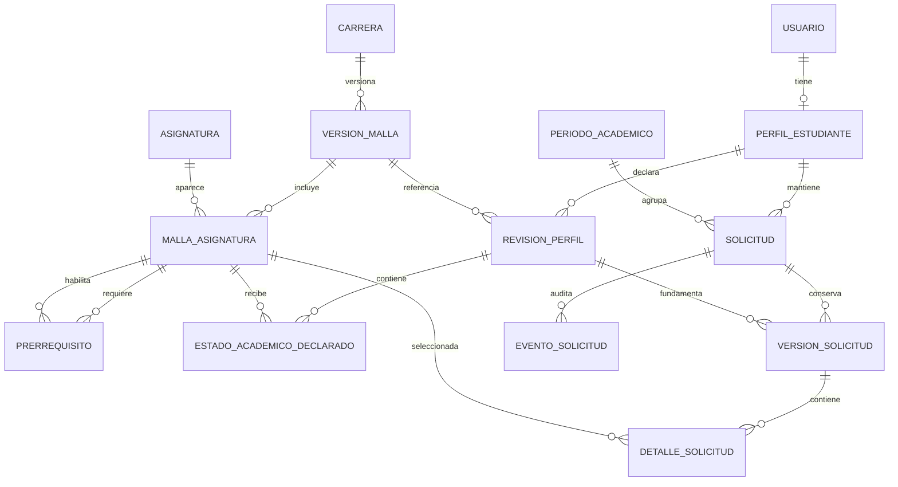

# PREVIA — Modelo relacional propuesto para MySQL

## Alcance vigente H05-A

**Confirmado y autorizado:** selección y borrador propio persistido, sin envío ni
reportes reales. Esta ampliación sustituye las restricciones históricas solo para
H05-A. Contratos, mecanismos adoptados, evidencia y pendientes en
[h05-a-drafts.md](h05-a-drafts.md). D03 y límites independientes se conservan.

## Alcance específico H02-C

**Confirmado e implementado:** persistencia aditiva de períodos, planificación de
cupos y notas administrativas, más fuente/fecha de revisión de reglas curriculares.
La autorización actual se limita a H02-C y conserva H02-A/H02-B; las menciones
históricas a fase 0 o autorización pendiente no describen esta entrega.
Véanse [tablas, límites, reportes futuros y evidencia H02-C](h02-c-planning.md).
Cupos orientativos no constituyen oferta ni condicionan selección; NULL o ausencia
significa desconocido, cero es explícito. Sin nuevas APIs ni cambios visuales,
de autenticación o de las 53 asignaturas. Solicitudes y reportes reales siguen
**pendientes**, al igual que servicios administrativos y datos institucionales.

## Estado de implementación H02-B

El usuario autorizó autenticación **solo local** con OTP, Mailpit, sesiones y
conexión Angular. Está implementada y verificada según
[alcance, configuración y evidencia H02-B](h02-b-authentication.md).
Las notas históricas sobre fase 0, ausencia de endpoints o H02-B pendiente se
limitan al estado anterior. No se autoriza perfil académico ni hitos posteriores.
Los dominios oficiales, privacidad/retención y administración siguen pendientes.

**Recomendado, no aprobado ni implementado.** Alineado con D01–D06 confirmadas; mecanismos técnicos recomendados y pendientes institucionales D07–D13
se distinguen en planning-review.md. No es DDL ejecutable.

## Extensión implementada H02-C

| Tabla / extensión | Relaciones y controles |
|---|---|
| periodo_academico | id; identificador/código único; inicio destino UTC; captura desde/hasta; zona; borrador/publicado; revisión positiva; CHECK de orden y de inicio obligatorio al publicar |
| planificacion_cupos | FK entrada curricular, período, usuario responsable opcional; UNIQUE(entrada, período); cupos nullable ≥0; actualizado_en UTC |
| nota_administrativa | FK planificación y autor; tipo observacion/propuesta/decision; contenido no vacío; creado_en UTC; índice cronológico por planificación |
| malla_asignatura | fuente_regla y regla_revisada_en opcionales, sin alterar los metadatos de incertidumbre existentes |

Las FK nuevas usan RESTRICT. La entrada curricular ya determina asignatura y
versión; no hay catálogo de oferta ni bloqueo por ausencia de planificación.
NULL/ausencia de cupos conserva brecha desconocida; cero es planificación explícita.
Autorización administrativa, validación IANA/publicación y cálculos de reportes
requieren servicios futuros, conforme al [contrato H02-C](h02-c-planning.md).

## Implementación parcial autorizada H02-A

Las nueve tablas académicas y de identidad básica se implementaron en H02-A,
con FK compuestas y restricciones descritas aquí. El resto del documento conserva
el diseño recomendado para futuras entregas. Se añadieron a `malla_asignatura`
`estado_regla`, `revision_pendiente`, `prerrequisito_texto_original` y
`condiciones_externas` para preservar incertidumbre curricular del piloto.
Las condiciones externas textuales no sustituyen aristas de prerrequisitos internos.
La malla se carga como borrador no oficial; no se implementan publicaciones,
evaluación, escrituras de perfil ni autenticación. Véase
[detalle y límites de H02-A](h02-a-persistence.md).

## Convenciones y propósito

Proponer InnoDB, claves primarias enteras, claves foráneas explícitas, texto utf8mb4,
fechas de negocio UTC con precisión suficiente y zona IANA de captura almacenada.
Elegir versión concreta de MySQL en fase 1 y comprobar soporte efectivo de CHECK;
no confiar en restricciones ignoradas por el motor. Identificadores de catálogo
son opacos: no inventar códigos reales. Alembic es la herramienta recomendada para
migraciones SQLAlchemy, con pruebas sobre MySQL, no solo SQLite.

Salvo indicación distinta, id es PK. FK obligatorias y NOT NULL donde la relación
es necesaria. Usar borrado RESTRICT para catálogo, solicitudes y revisiones; no
cascadas destructivas del historial. Política de anonimización/retención pendiente
D10; auditoría inmutable durante su retención, no almacenamiento eterno obligatorio.

## Tablas, claves y relaciones

| Tabla | Campos esenciales y relaciones | Unicidades y controles |
|---|---|---|
| usuario | id, correo_normalizado, creado_en, activo | UNIQUE(correo_normalizado); normalización D08 |
| rol / usuario_rol | rol(id, nombre); usuario_rol(usuario_id, rol_id) | PK compuesta de asignación; roles estudiante/administrador propuestos; alta privilegiada |
| perfil_estudiante | id, usuario_id | UNIQUE(usuario_id), FK usuario; identidad estable |
| carrera | id, codigo, nombre | UNIQUE(codigo), sin datos reales inventados |
| version_malla | id, carrera_id, codigo_version, estado_publicacion, revision_control | UNIQUE(carrera_id, codigo_version); borrador/publicada propuestos |
| asignatura | id, identificador_catalogo, nombre | UNIQUE(identificador_catalogo) solo dentro del catálogo local acordado; validar identidad al importar |
| malla_asignatura | id, version_malla_id, asignatura_id, semestre_curricular, codigo_publicado, nombre_publicado | UNIQUE(version_malla_id, asignatura_id); semestre positivo; atributos curriculares pertenecen a la relación |
| prerrequisito | version_malla_id, asignatura_id, requisito_asignatura_id | PK triple; ambas referencias compuestas a malla_asignatura(version_malla_id, asignatura_id); distinta asignatura/requisito |
| revision_perfil | id, estudiante_id, numero, version_malla_id, semestre_declarado, creado_en | UNIQUE(estudiante_id, numero); UNIQUE(estudiante_id, id); instantánea inmutable; carrera derivada de malla |
| estado_academico_declarado | revision_perfil_id, malla_asignatura_id, estado | PK compuesta; estado: aprobada/reprobada/no_cursada; ausencia significa desconocido, nunca aprobada ni no_cursada (D03 confirmada) |
| periodo_academico | id, identificador, inicio_periodo, captura_desde, captura_hasta, zona_horaria, estado_configuracion, revision_control | UNIQUE(identificador); desde < hasta; hasta < inicio_periodo si existe; inicio UTC nullable solo en borrador, obligatorio para publicar; borrador/publicado propuestos; período destino, ventana anterior, UTC y zona IANA configurable (D06 confirmada) |
| solicitud | id, estudiante_id, periodo_id, estado, revision_control, version_vigente_id nullable, version_trabajo_id nullable | UNIQUE(estudiante_id, periodo_id); UNIQUE(id, estudiante_id); una principal permanente |
| version_solicitud | id, solicitud_id, estudiante_id, numero, revision_perfil_id, origen, creado_en | UNIQUE(solicitud_id, numero); UNIQUE(solicitud_id, id); FK(solicitud_id, estudiante_id) y FK(estudiante_id, revision_perfil_id) aseguran dueño |
| detalle_solicitud | version_id, malla_asignatura_id, prioridad | PK(version_id, malla_asignatura_id); FK malla_asignatura; prioridad alta/media/baja |
| envio_idempotente | id, estudiante_id, periodo_id, clave, huella_cuerpo, solicitud_id, version_enviada_id, respuesta_json, creado_en | UNIQUE(estudiante_id, periodo_id, clave); FK a principal y versión de esa principal; solo éxitos confirmados, inmutable |
| evento_solicitud | id, solicitud_id, version_id nullable, actor_usuario_id, tipo, instante, motivo | FK compuesta(solicitud_id, version_id) cuando existe; historial de guardar/enviar/actualizar/retirar/invalidar/recuperar |
| desafio_otp | id, correo_normalizado, proposito, codigo_digest, emitido_en, expira_en, consumido_en nullable, intentos, invalidado_en nullable | Índice(correo_normalizado, proposito, emitido_en); no guardar código en claro; no requiere usuario existente |
| sesion | id, usuario_id, token_digest, creado_en, expira_en, revocado_en nullable | UNIQUE(token_digest); FK usuario; nunca token en claro en BD |
| evento_seguridad | id, actor_usuario_id nullable, tipo, instante, referencia_minima | Sin OTP, tokens o cuerpos sensibles; retención D10 |

Los punteros vigente/trabajo usan FK compuestas (solicitud.id, version_id) contra
version_solicitud(solicitud_id, id): no pueden apuntar a otra solicitud. Se crean
nulos al insertar la principal y se asignan después de crear su revisión en la
misma transacción. Las migraciones resuelven esta dependencia circular agregando
las FK después de ambas tablas. «origen» describe creación de revisión; los eventos
registran su uso posterior sin modificar contenidos históricos.

Para estado_academico_declarado, proponer version_malla_id redundante con dos FK
compuestas: (revision_perfil_id, version_malla_id) a revision_perfil y
(malla_asignatura_id, version_malla_id) a malla_asignatura; añadir sus UNIQUE de
soporte. Así un estado no puede pertenecer a otra malla. Es redundancia técnica
controlada, no una carrera duplicada.

**Recomendado:** detalle_solicitud referencia directamente malla_asignatura, no
asignatura. Se deriva asignatura_id mediante esa relación; no duplicarlo en detalle.
La PK impide repetir la misma entrada curricular y UNIQUE(version_malla_id,
asignatura_id) impide dos entradas para la misma asignatura en una malla.
Al guardar y al enviar, el servicio comprueba, dentro de la transacción, que cada
malla_asignatura.version_malla_id coincide con la malla de revision_perfil de la
version_solicitud. Una FK simple garantiza existencia, pero no esa igualdad entre
tablas: no atribuirle esa protección. Se recomienda esta validación centralizada
antes que propagar otra clave redundante por versiones y detalles. Incluso un
borrador rechaza referencias de otra malla; solo puede conservar incompatibilidades
académicas (estado/prerrequisitos) como advertencias. Probar ambas garantías por separado.

## Diagrama conceptual

El diagrama simplifica FK compuestas y punteros; la tabla anterior define sus controles.

## Invariantes y normalización

- Una asignatura existe una vez en catálogo y puede aparecer en varias mallas.
  Su semestre y requisitos varían por versión. No guardar prerrequisitos en JSON
  ni listas separadas por comas. Todos los requisitos configurados se cumplen
  conjuntamente (AND). Alternativas OR, equivalencias y correquisitos quedan fuera
  hasta documentación y aprobación de una extensión del modelo.
- Publicar una malla valida referencias y ausencia de ciclos mediante recorrido
  del grafo; una FK no detecta ciclos. Versiones publicadas no se editan (D11).
- Semestre declarado pertenece a la revisión del perfil y no bloquea selección.
  Semestre curricular pertenece a malla_asignatura. Carrera se deriva de la malla.
- Revisiones completas e inmutables de perfil y solicitud permiten reproducir
  reportes y cambios. No representan transcripciones oficiales ni períodos de
  intentos académicos. No se almacena un número de reprobaciones inexistente.
- Duplicado por versión se impide con PK del detalle; duplicado por período con
  UNIQUE de principal. Solo version_vigente_id participa del reporte.
- Máximos agregados 3 altas, 4 medias/bajas y 7 total no se resuelven con CHECK de
  fila: el servicio valida la colección completa dentro de la transacción.
  Envío exige al menos una materia de cualquier prioridad; borrador puede estar vacío.
  CHECK limita valores individuales y coherencia local donde sea posible.
- La revisión de perfil activa propuesta es la última por número por estudiante;
  serializar creación bajo bloqueo de perfil_estudiante. Las versiones de solicitud
  conservan la revisión usada. No elegir «última» por timestamp ambiguo.
- Autorización, ventana abierta, pertenencia curricular, mínimos y prerrequisitos
  son invariantes del servicio; los clientes no escriben directamente en tablas.

La transacción de cambio del historial debe excluir toda solicitud incompatible
en captura y preservar revisiones/eventos; no basta validar cada detalle al insertar.
Tras cierre, los punteros y revisiones que fundamentan el reporte permanecen estables
aunque cambie el perfil. Este es un requisito confirmado D04; los bloqueos y
revisiones son mecanismos propuestos. La configuración del período expresa una
ventana anterior al semestre destino; no se inventan fechas ni calendario oficial.

## Índices y extensión condicionada

Índices de apoyo a FK y consultas: solicitud(periodo_id, estado, version_vigente_id),
detalle_solicitud(malla_asignatura_id, prioridad, version_id),
evento_solicitud(solicitud_id, instante, id), sesion(usuario_id, expira_en),
y prerrequisito(version_malla_id, requisito_asignatura_id). Evaluar planes con
EXPLAIN y datos sintéticos antes de añadir índices redundantes a UNIQUE/PK.

D05 confirmado excluye tabla y catálogo independiente de oferta por período en v1.
La selección proviene de pendientes de la malla y representa interés potencial.
**Confirmado para v1 en esta revisión:** una sola malla activa por perfil académico,
la de su última revision_perfil; conservar revisiones anteriores no activa otras mallas.
Sin equivalencias, correquisitos, oferta por período ni matrícula oficial.
**Restricción técnica recomendada mientras D11 siga pendiente:** elegir carrera/malla
al crear el perfil y rechazar cambios posteriores por la API ordinaria. Publicar una
nueva malla no migra perfiles. Transferencias de carrera, migración de malla, traslado
de estados y tratamiento de solicitudes abiertas requieren decisión posterior; no
copiar aprobaciones ni mapear materias automáticamente. No implementar estos cambios
antes de aprobar su política. D04 sigue aplicándose a cambios del historial dentro
de la malla actual.

## Coexistencia de envío vigente y trabajo

**Recomendado:** estado pertenece solo a solicitud, no duplicarlo en cada versión.
Versiones y detalles son inmutables; eventos registran envíos y transiciones.

| Estado principal | version_vigente_id | version_trabajo_id | Demanda |
|---|---|---|---|
| borrador | Nulo | Obligatorio | Ninguna |
| enviada | Obligatorio | Nulo o distinto de vigente | Solo vigente |
| retirada / invalidada | Nulo | Nulo o revisión de trabajo conservada | Ninguna |

CHECK local para esta matriz y para punteros distintos; FK compuestas para pertenencia.
El servicio verifica que vigente tenga evento de envío (o renovación compatible de
fundamento) y que trabajo sea una revisión aún no enviada. No deducir vigencia del
mayor número de versión ni de origen. Guardar sobre enviada reemplaza solo trabajo;
la principal sigue enviada aunque el trabajo esté vacío o tenga advertencias.
Enviar valida trabajo contra el perfil actual, reemplaza vigente, limpia trabajo y
registra el evento atómicamente. Si falla, ambos punteros quedan intactos. Retirar
quita vigente y conserva el trabajo existente; recuperar crea una nueva copia de
trabajo del trabajo conservado o, si no existe, del último envío registrado, y pasa
a borrador sin contar. D04 revalida la versión vigente, no solo el trabajo: una
incompatibilidad del envío quita vigente y marca invalidada aunque exista borrador.
Conservar ese trabajo no permite contar hasta un nuevo envío válido.
Una actualización compatible del perfil renueva el fundamento del envío mediante
una versión equivalente y evento, sin enviar ni sobrescribir el trabajo pendiente;
este se revalida contra el perfil actual antes de enviarlo. Tras cierre nada de ello
modifica el fundamento histórico.

## Conservación curricular y límites de prioridad

**Recomendado, pendiente de aprobación técnica/D11:** al publicar, copiar código y
nombre de catálogo a codigo_publicado/nombre_publicado de malla_asignatura y congelar
la versión completa: pertenencias, semestre curricular, etiquetas y prerrequisitos.
El catálogo conserva identidad estable; sus cambios de nombre/código no se usan para
reetiquetar reportes históricos. Carrera y etiqueta de versión referenciadas por una
publicación también quedan inmutables; corregirlas exige otra publicación. No borrar
ni reasignar identidades referenciadas (RESTRICT). Así se reproduce el fundamento de
un reporte usando versión de solicitud, revisión académica y publicación curricular,
sin duplicar toda la malla en cada solicitud. Una nueva publicación no sustituye
referencias anteriores. Tras cierre se mantienen esos punteros y datos; no recalcular
con perfil o catálogo actuales. Reproducción durante la retención acordada en D10;
correcciones retrospectivas siguen pendientes D11. Para v1 se recomienda separar versiones en los agregados según architecture.md; no inferir equivalencias (D13).

**Confirmado D02:** contar A=altas y B=medias+bajas conjuntamente. Exigir A≤3,
B≤4 y A+B≤7 en borrador y envío; envío exige además A+B≥1. No existe bolsa
transferible: 1+6, 0+5 y 2+5 fallan; 0+4 y 3+4 pasan. El mínimo no se exige al
borrador. Validar siempre la colección completa en backend, incluidas actualizaciones.

## Consolidación técnica: período e idempotencia

**Recomendado:** `inicio_periodo` es el instante UTC de inicio del período de destino,
con entrada ISO 8601 con desplazamiento explícito; `zona_horaria` IANA sirve para
presentación. No es fecha de matrícula ni de oferta. Borrador puede omitirlo, pero
publicar exige `captura_desde < captura_hasta < inicio_periodo` y reloj servidor
`ahora < inicio_periodo`. Validar en backend y reforzar el orden con CHECK;
congelar los tres instantes al publicar. Ventana operativa propuesta:
`captura_desde <= ahora < captura_hasta`. Rechazar horas sin desplazamiento,
zonas inválidas y desplazamientos incompatibles con la zona; no resolver horas
ambiguas por inferencia. Las fechas se suministran por configuración autorizada,
o como fixtures sintéticos explícitos; no se derivan del identificador del período.

`envio_idempotente` guarda el resultado de submit en la misma transacción que
revisión, evento y punteros. Su huella corresponde al cuerpo validado y canonizado
(incluye revisiones e ID de trabajo), no a bytes JSON ni credenciales. Conservar
el registro mientras se conserve la solicitud según D10; no caducarlo durante su
uso local. No almacenar cookies ni datos ajenos. El contrato y orden de consulta
se detallan en api-design.md. No es una segunda solicitud ni una versión contable.
